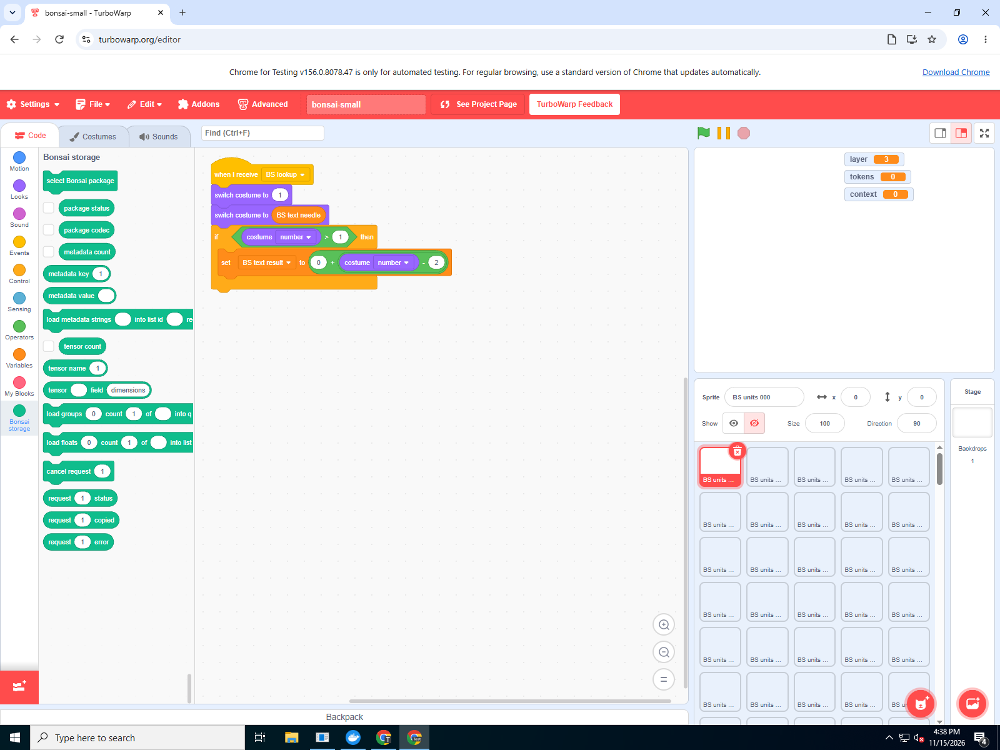
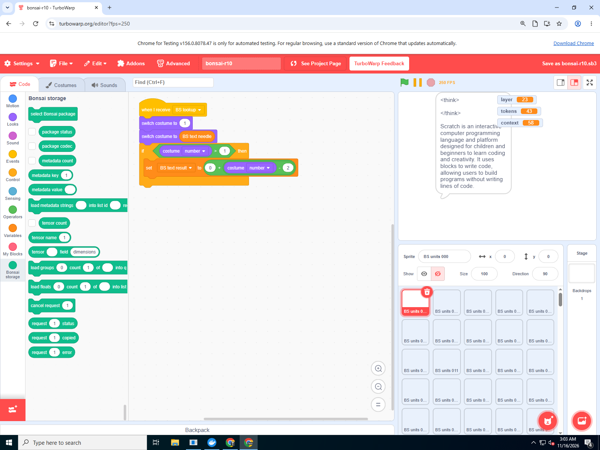
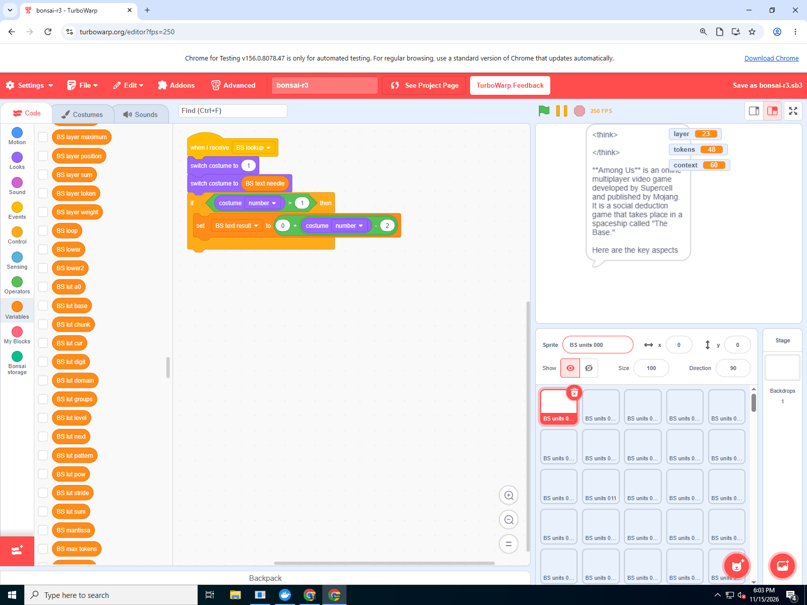

# I ran a 2B language model entirely inside Scratch

Yes, [that Scratch](https://scratch.mit.edu/). And it took almost half an hour just to
answer what Scratch is.

[](https://github.com/akorite/ScratchLM/stargazers)

<video src="https://github.com/akorite/ScratchLM/raw/main/docs/media/demo-eos.mp4" controls poster="https://github.com/akorite/ScratchLM/raw/main/docs/media/final-output.png" width="640"></video>

*[Watch the recording directly](https://github.com/akorite/ScratchLM/raw/main/docs/media/demo-eos.mp4)*

It is extremely slow, but hell, it works.

## What is this?

The whole inference engine is implemented inside Scratch — no inference API calls, no
external servers, no JavaScript neural network computation. The generated Scratch blocks
run inside [TurboWarp](https://turbowarp.org/) because of the project's size and
execution requirements. There is a small custom JavaScript extension, but it only loads
the model weights and moves data around. All the actual model math happens inside
Scratch blocks.

The model is [PrismML's Ternary Bonsai 2 2B](https://huggingface.co/prism-ml/Ternary-Bonsai-2-2B-gguf),
PQ2_0 quantized, about 517 MB of ternary weights packed into a ~537 MB custom package
that Scratch loads separately.

## Does it actually answer questions?

Yes. I tested it with 10 different runs, mostly simple questions. Some of the results:

| Prompt | Result | Time |
|---|---|---|
| What is 4+4? | 8 | ~10 min |
| Capital of France? | Paris | ~11 min |
| What is 2+2? | 4 | ~10 min |
| What color is the sky? | Blue | ~10 min |
| What is Scratch? Be brief. | Full 2-sentence answer, 43 tokens | ~29 min |

The simple questions worked — although taking 10 minutes to answer 4+4 isn't exactly
impressive from a performance perspective.

| What it looks like | |
|---|---|
|  |  |
|  |  |

## How does it work?

The Scratch project isn't manually built by dragging thousands of blocks around — a
generator produces ~65,000 sprites worth of blocks. When you enter a prompt, Scratch
tokenizes the text (yes, even tokenization happens in blocks), runs the data through all
24 layers for each new token, then scans all 248,320 vocabulary entries to greedily pick
the next one. The answer appears in a sprite's speech bubble, one token at a time.

The tokenizer is stored inside the model package itself, and the ternary weights are
packed losslessly — five ternary digits per byte — so no extra precision is lost.

## Performance

As expected, it's pretty bad. Really bad.

Around **0.03 tokens per second** — roughly 2 tokens per minute, ~30 seconds for a single
token. Prompt prefill is another 25–50 seconds per prompt token, so expect 7–12 minutes
before the model even starts answering.

The context window is 128 cells (prompt + reply combined), so long answers get cut off —
one 80-minute run generated 116 tokens and then just ran out of context. Memory peaked
around 4–5 GiB. Also, the TurboWarp tab has to stay in the foreground: browsers throttle
background tabs and the whole thing gets even slower.

This is roughly 10,000× slower than llama.cpp on the same weights. The point was never
speed.

## Can you actually run it?

Yes! Everything is here. You'll need:

- [TurboWarp](https://turbowarp.org/) (the web editor works)
- The model GGUF — `model-lock.json` records the pinned file and SHA-256
- Python 3 for the packaging step
- Enough RAM and patience

```sh
python3 tools/package_model.py model.gguf model-bslut5-tokenizer.bsp --codec bslut5
```

This builds the ~537 MB package and verifies every weight byte-for-byte. Then open
`dist/bonsai-prompt-to-text.sb3` in TurboWarp, load `extension/loader.js` as a custom
extension (tick **"Run extension without sandbox"** — only do this for extensions you
trust), run the `select Bonsai package` block, wait for `package status = ok`, press the
green flag, and type a prompt.

The repo also includes tests that diff Scratch's output token-for-token against a pinned
native llama.cpp build — that's how I verified the blocks were doing real inference and
not just producing plausible-looking text.

## Want the technical details?

The plan and the measurements live in `docs/`:

- `docs/bonsaiscratch-plan-v1.1.md` — architecture, packaging format, execution modes
- `docs/levers.md` — performance levers that were measured (prefill, batching, head scan)
- `docs/m3-decision.md` — why bslut5 won
- `spec/` — the execution and numerics specs
- `tools/generate_project.py` — the generator that produces the project
- `tools/package_model.py` — the packager

## Star history

[](https://star-history.com/#akorite/ScratchLM&Date)
