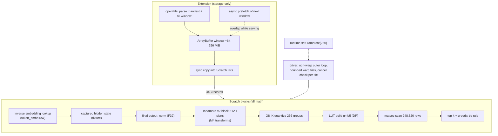

# Scratch speed redesign and M4 integration - Plan

## Goal Capsule

- **Objective:** a compiled TurboWarp project that produces correct next-token output (transformed activations, embedding lookups, all 248,320 head logits, top-k and greedy choice) at a measured decode cost inside the 30–120 s demonstration band on the test host — evidence sufficient to lift the M3 pause on integration.
- **Means:** remove per-request scheduler parks with a synchronous sliding-window loader, raise the project step rate to 250 fps, retune tile size against the cancellation bound, benchmark the `bslut5` deeper trit-LUT codec, then integrate Hadamard transforms, embeddings, and the full head in Scratch blocks (KTD1–KTD6).
- **Authority:** `docs/bonsaiscratch-plan-v1.1.md` governs the numerical contract, execution boundary, and milestone exit criteria; `docs/numerical-contract.md` governs tolerances; `docs/speed-research-m3.md` is the evidence for the speed redesign.
- **Execution profile:** one branch (`feat/bonsaiscratch-m0-m3` continues), two mergeable groups — speed redesign first, M4 second; no remote exists, so groups land as commit sets on the branch.
- **Stop conditions:** `bslut5` that cannot round-trip or loses to cursor-form BS-LUT4 on measured scan+build cost reverts to BS-LUT4 and the plan continues without it; if compiled-VM decode evidence still exceeds the 5-minute pause trigger after transport fixes, stop before M4 unit work and update the decision record instead; if Hadamard nodes cannot be captured by the pinned reference harness, fall back to documented offline goldens per KTD7 rather than weakening M4 exit criteria.
- **Who finishes:** implementer executes U1–U9; the M4 decision to proceed to M5 (per-layer state) is a separate gate after this plan's evidence lands.

---

## Product Contract

### Summary

Lift the M3 pause on decoder integration by eliminating the scheduler-pacing cost measured in the head scan — then implement the M4 milestone: Hadamard transforms, embeddings, final normalization, and the full tied output head with greedy selection, all inside visible Scratch blocks.

### Problem Frame

The M3 record paused integration on two findings: ~33 of 35 s of the head scan was scheduler-side, not arithmetic or I/O, and projected decode (129–155 s/token) sat in the research-only band. Post-M3 research (`docs/speed-research-m3.md`, verified against the pinned VM source) traced the cost to per-request promise parks plus the sequencer's 75% work-time duty bound, and measured variants that collapse it. The remaining question — whether the project can demonstrate a working output head at demonstration-band decode cost — is what this plan answers. Without it, M5–M8 layer integration has no measured foundation.

### Requirements

**Speed redesign**

- R1. The loader serves `loadGroups`/`loadDense` copies synchronously from a bounded read-ahead window; a window miss refills asynchronously with the next window already prefetching while the current one serves, preserving the existing request/owner/generation staleness and cancellation semantics.
- R2. The deployed project runs at the TurboWarp framerate that removes the per-request frame tax (250 fps measured on host); the mechanism must be inside the project/extension boundary and documented.
- R3. Tile size is retuned so cancellation latency (≈ tile wall time) stays under the 250 ms target at the new pacing; the contract's 50 ms uninterrupted-tile goal is superseded by the cancellation bound (recorded, not dropped silently); measured worst event-loop gaps are recorded.
- R4. The `bslut5` base-3 index codec (5 trits per index byte, in-record) is packaged and benchmarked against a cursor-form `bslut4` baseline on identical quantized inputs; adopted only on measured win with lossless round-trip. g=6 is excluded — it cannot fit `unit=34`.
- R5. The M3 decision record is revised with the new measured decode/prefill projections and an updated proceed/hold verdict, host-only caveats preserved.

**M4 integration**

- R6. New deterministic native fixtures: Hadamard-v2 block-512 input/output pairs for widths 2048 and 6144 with sign vectors and tensor associations, embedding-row lookups, final output_norm pair, and compact head top-k/margin goldens — all with build/seed/context provenance per the existing fixture schema.
- R7. Scratch blocks implement normalized Sylvester-Walsh-Hadamard block-512 with explicit signs, the tensor-specific folded-weight paths, the inverse embedding path, tied-output behavior, and final normalization — transform → activation quantization → matvec in native order.
- R8. The compiled project scans all 248,320 vocabulary rows, produces logits/top-k agreeing with native fixtures, selects the next token greedily under a documented tie rule, and reports measured latency and memory; no vocabulary pruning.

### Key Decisions

- **KD1. Speed redesign precedes M4 units** — the user chose to plan M4 on the assumption transport targets hold rather than after they land. Governs R1–R8: M4 units build on the retuned driver and codec the redesign produces. (session-settled: user-directed — chosen over transport-only or redesign-only-first: user asked to reach for a working LLM, and the research evidence makes the pause liftable.)
- **KD2. The all-Scratch math boundary is unchanged** — inherited from the original plan: extension does storage I/O and bounded copies only. Governs R1, R7, R8; offline package recoding stays a format operation, not runtime math.

### Success Criteria

- Compiled-VM head scan wall time ≤ ~22 s for 248,320 rows on the test host (from 34.97 s baseline).
- Projected decode ≤ 120 s/token on the test host with ≥1 measured kernel path.
- Compiled-VM tests green: 38 pytest + 5 node transport + new coverage for window misses, codec round-trip, transform pairs, and head top-k.
- Cancellation latency ≤ 250 ms and worst uninterrupted interval reported at the chosen tile size.
- Revised `docs/m3-decision.md` verdict states whether M5 may proceed, with host-only and prefill limitations called out.

### Scope Boundaries

- **Deferred to follow-up work:** prefill-attention-path acceleration (prefill stays hours-scale at 128 tokens — disclosed, not solved); browser-renderer and Ryzen-target validation; production tokenizer and EOS streaming (M7); per-layer recurrent/KV/convolution state (M5) and the 24-layer decoder loop (M6).
- **Considered and not built:** CSR sparse index-list matvec — measured 32.6% trit-zero density makes it slower than LUT per `docs/speed-research-m3.md`; warp-mode driver — the original contract prescribes a non-warp driver with bounded warp tiles and the measured gain was nil; mirror-consolidated LUTs — per-lookup negate costs more than halved build; whole-model resident lists — violates the bounded-transport design and target memory.
- **Outside this product's identity:** any math inside the extension, any VM source patch, any native runtime call at inference time.

---

## Planning Contract

### Key Technical Decisions

- KTD1. **Sync sliding-window loader.** `load()` becomes synchronous: copies are served from an in-extension `ArrayBuffer` window (default ~64–256 MiB, sized against the 6 GB browser gate) covering the request; `openFile` caches the window eagerly; misses await one refill while the previous window's tail may already be prefetching the next region. All `requests`/`owners`/`generation` staleness and `cancel` semantics stay; a sync copy that completes in-block can only ever read `ok`/`error`, so `status`/`copied` reporters and `docs/extension.md` wording update together. The 4 MiB request bound and `unit=34` are unchanged. Evidence: promise parks measured at ~16.7 ms/request; window removes parks while keeping the bound.
- KTD2. **Framerate via the extension, not project.json.** `project.json` has no framerate field; the loader already holds `this.runtime` — `openFile` (or first use) calls `runtime.setFramerate(250)`. Documented as an extension side effect in `docs/extension.md`; Chrome background-tab throttling (non-rAF timers clamp toward 1 Hz) is a declared risk, not solved.
- KTD3. **Index stream lives inside the 34-byte record; the stored byte IS the index.** A `bslut5` codec packs 26 base-3 index bytes per record (25 full 5-trit groups + one tail slot), replacing the 32 code bytes and leaving 6 required-zero spare bytes. Scratch adds only the chunk base per lookup — computing indices in blocks would cost ≥2 ops/trit and erase the win. A separate offline index stream was rejected: it changes payload layout and adds ~26 B/record of duplication (~103 MB) for no measured gain; in-record placement spends the 6 B slack to keep `unit=34`. g=6 cannot exist under `unit=34` (21 indices × 729 values need ≥10 bits each) and is out of scope.
- KTD4. **LUT build via pinned DP, zero multiplies.** Per chunk, `LUT[p] = LUT[chunk_base + (p mod level_pow)] + floor(p/level_pow)·a_level` (equivalently `LUT[p − level_pow] + a_level`), `level_pow ∈ {1,3,9,27,81}` with the activation cursor bumping at thresholds {3,9,27,81} — ~10–11 ops/entry vs ~3× for per-pattern recompute. The tail chunk's pad trits only ever read entries whose coefficients are zeroed, so dead entries stay finite. LSD-first index (`t0 + 3·t1 + 9·t2 + 27·t3 + 81·t4`) matches the existing `bslut4` digit convention; the same DP applies to g=4 so the benchmark baseline gets it too.
- KTD5. **Groups align per record — no straddle exists to solve.** The weight scale is per-record, so a 5-trit group can never span records; each record's trits map inside exactly one 256-activation Q8 window. The tail is a fixed 3-trit slot per record (128 = 25×5+3), padded with field value 1 (the zero trit) so every byte is a valid 5-trit index — the scan is branch-free. Dead index ranges in the tail slot are packer-rejected.
- KTD6. **M4 uses the existing benchmark harness shape.** The head-mode tile loop in `scratch/lut.py` is the 248,320-row skeleton; transforms/embedding/norm are new `scratch/` modules and generator modes; the greedy + top-k evidence path writes compact margins, not a 1 MB logits file.
- KTD7. **Fixture capture reuses the pinned harness; offline goldens are the fallback.** `reference.py --project-pq2`/`--capture` produce arbitrary-tensor goldens; Hadamard pairs are captured pre/post transform if the pinned graph exposes them, else computed offline (normalized Sylvester, block 512, explicit signs) and marked. Sign vectors and the folded/inverse associations are emitted as **dense manifest tensors** by `package_model.py` — `metadataValue` returns JSON strings unsuitable for 2048-element arrays; the manifest already supports dense F32 tensors.

### High-Level Technical Design

### Assumptions

- 250 fps survives in a packaged TurboWarp build (verified on the audited VM source, `runtime.setFramerate` cap 250; packaged-app persistence unverified).
- `item of` stays O(1) on lists up to ~300k+ entries; if it degrades, LUTs split per k-block.
- Hadamard transform nodes are reachable by the reference `--capture` filter; if not, KTD7's offline-golden fallback applies and is marked in fixtures.
- The user intends a working next-token demonstration on this host, not a target-hardware performance claim.

### Sequencing

PR group 1 (speed redesign): U1 loader → U2 framerate+driver → U3 codec → U4 re-benchmark+decision. PR group 2 (M4) waits on group 1 merging: it reuses the retuned driver, codec, and harness. U5 fixtures can technically start parallel but is placed in group 2 to keep one creator per fixture schema.

---

## Implementation Units

### PR1: Speed redesign

*Waits on: nothing (starts on current branch).*

### U1. Synchronous sliding-window loader

**Goal:** `loadGroups`/`loadDense` complete synchronously when the request overlaps the cached window; misses await one refill; semantics otherwise identical.

**Requirements:** R1, KD2. **Dependencies:** none.

**Files:** `extension/loader.js`, `tests/transport/loader.test.js`, `tests/transport/bounds.test.js`, `docs/extension.md`, `benchmarks/transport.js`.

**Approach:**
1. `openFile` (stays async — file picker and manifest parse unchanged): after manifest validation, read a bounded window (default 64 MiB covering payload start) into an internal buffer; kick off an async prefetch of the next window region.
2. `load()` and the `loadGroups`/`loadDense` entry points: drop `async` wrappers (an async wrapper still parks ≥1 frame through `waitPromise` even when resolving same-tick). Compute the byte range; if fully inside the window, do the existing typed-array → `list.value` copy inline and set status `ok`; if it straddles or misses, return a promise that awaits the refill (or a new read for out-of-window ranges) then performs the same copy — parks only on misses.
3. Window advance: when a served request ends within a threshold of the window tail, advance/refill and prefetch the region after — sequential tensor scans prefetch ahead by construction.
4. Keep every staleness check: `generation`, `requests`, `owners`, ownership revalidation before copy, stale-marking on new requests; cancel marks pending and never publishes.
5. `docs/extension.md`: rewrite Transfers wording — status can go `pending→ok` across a refill; a sync copy completes before `status` can observe `pending`; cancellation cannot interrupt an in-flight synchronous span.

**Test scenarios:**
- Window hit: `loadGroups` returns a non-promise — a same-tick-resolved Promise still parks ≥1 frame through `waitPromise`; `status` reads `ok` immediately; copied counts exact.
- Window miss mid-tensor: request completes with correct payload after one refill; `status` observed `pending` during refill; `copied` correct after.
- Sequential scan across window boundary: two adjacent tiles straddling the boundary both land; prefetch had already started the second window.
- Cancellation during a refill: `cancel` marks `cancelled`; no data is published to the lists.
- Stale ID mid-refill: a second request with the same ID marks the first `stale`; the first's completion publishes nothing.
- Changed list ownership between issue and copy completion: request fails closed, no publish.
- Max-bound request (`floor(4MiB/34)` groups) still accepted; request exceeding window capacity uses the direct-read fallback and completes correctly.
- `fileStatus`/`codec`/metadata reporters unchanged; selecting a new file bumps generation and stale-marks in-flight requests.

**Verification:** node transport suite green plus new miss/refill cases; measured per-request total_ms drops from ~16 ms floor to sub-ms on window hits in `benchmarks/results/transport-*.json`.

### U2. Framerate and driver retune

**Goal:** the generated benchmark/project applies 250 fps and the tile size that keeps cancellation ≤250 ms.

**Requirements:** R2, R3, KD2. **Dependencies:** U1.

**Files:** `extension/loader.js` (framerate side effect), `tools/generate_project.py`, `scratch/lut.py`, `tests/scratch/test_head.py`, `tests/scratch/test_transport_integration.py`, `docs/extension.md`.

**Approach:**
1. Loader calls `this.runtime.setFramerate(250)` once at `openFile` success; documented in extension.md as an app-visible side effect.
2. `BS tile size` default retunes to ~1,920 rows at width 2048 (and the width-6144 equivalent that keeps tiles under the bound); `generate_project.py` still exposes it as a variable so tests override.
3. Keep the non-warp outer loop per the contract's responsive-execution design; cancellation check stays per tile; `control_wait 0` yield retained as the explicit boundary the contract requires.
4. `docs/extension.md` gains a pacing note: expected step rate, background-tab throttle caveat.

**Test scenarios:**
- Generated project loads a row with framerate 250 applied (asserted via `runtime.framerate`/observable pacing, not string inspection).
- Cancellation flag set before a tile: scan aborts within one tile's wall time; measure and record it.
- Tile counts: 1,920-row tiles produce ceil(248320/1920) loader requests; last partial tile copies only its remainder.
- Resident-tile test still passes with loader disabled after load (isolation invariant).

**Verification:** benchmark variant reproduces the measured transfer collapse (~0.1 s per 48k rows at 250 fps/tile-1920) and worst event-loop gap is recorded per run.

### U3. `bslut5` codec and parameterized LUT kernel

**Goal:** a benchmarked `bslut5` codec — 26 in-record index bytes — plus a cursor-form parameterized kernel that gives the `bslut4` baseline the same optimizations, adopted only on measured win.

**Requirements:** R4, KTD3–KTD5. **Dependencies:** U1, U2.

**Files:** `tools/package_model.py`, `docs/model-format.md`, `fixtures/package-checksums.json`, `scratch/lut.py`, `tools/generate_project.py`, `extension/loader.js`, `tests/test_package.py`, `tests/scratch/test_lut.py`, `benchmarks/kernels.py`.

**Approach:**
1. Codec spec (per KTD3–KTD5): record = FP16 scale (2 B) + 26 index bytes + 6 required-zero spare. Byte j (j=0..24) = LSD-first base-3 index of trits 5j..5j+4 ∈ [0,242]; byte 25 = tail index = trits 125–127 + 108 (pad fields 1,1) ∈ [108,134]. Encoder rejects field 3; decoder validates idx<243, tail ∈ [108,134], spare = 0.
2. `package_model.py`: new `codec` value `bslut5`; repack per record (extract 128 fields, emit 26 indices + 6 zeros); deterministic decode invert; reverse-verify every group; checksums entry. `docs/model-format.md` gains the record layout.
3. `scratch/lut.py`: parameterize the kernel on `lut domain` (81/243) and index count (32/26); the inner loop becomes cursor form — `byte cur` and `lut cur` advance by +1 and +domain per lookup, `repeat(32|26)` — replacing the per-byte `byte_index`/`lut_byte_index`/`group0` recompute. LUT build uses the KTD4 DP with `level pow` and activation-cursor threshold variables; `q8_offset` becomes a per-record-half window cursor `(r mod 2)·128 + 5j`. No tail branch anywhere.
4. `benchmarks/kernels.py`: identical Q8_K inputs and rows, parameterized kernel run as cursor-`bslut4` baseline vs `bslut5` — the codec claims credit only over the cursor baseline, not the current index-recompute kernel (cursor form is ~2.7× scan per op-count analysis of `lut.py`'s ~19→7 ops/lookup; codec margin ~1.2×).
5. Selection: keep `bslut5` only if build+scan total beats cursor-`bslut4` on the same host; otherwise it stays out and the record says so. LUT flat length ~101k entries at K=2048, ~303k at K=6144 — verify `item of` stays O(1); fallback is per-Q8-block segmentation with one extra base add per chunk.

**Test scenarios:**
- Round-trip: all 3^5 = 243 pattern space recodes and reverses bit-exactly; every actual tensor group round-trips.
- Tail invariant: every record's byte-25 index ∈ [108,134]; a synthetic record with nonzero trits only at positions 125–127 produces the correct dot; spare bytes nonzero → reject; idx ≥243 or tail <108 → reject.
- Wrong-codec rejection: a `bslut5` file fails loudly when the loader's codec allowlist and `lut.py`'s `valid` check lack `bslut5`, never silently misdecodes — U3 adds `bslut5` to both allowlists; the loader copies all 32 code bytes per record (stride 32 unchanged, spare bytes ignored), staying codec-agnostic I/O.
- Bit-identity by construction: `bslut5` output is bit-identical to `bslut4` on the same rows (integer subtotal associativity) — asserted as a consistency property, not a tolerance.
- Cursor-form `bslut4` correctness: cursor kernel produces identical output to the index-recompute kernel on real rows.
- LUT O(1) check: scan time per lookup does not degrade between ~100k and ~300k entry LUTs; if it does, per-Q8-block segmentation is applied.

**Verification:** `tests/test_package.py` + `test_lut.py` green; `benchmarks/results/kernels-*.json` shows adopted codec's margin over the cursor baseline; selection recorded.

### U4. Re-benchmark and revised decision record

**Goal:** measured decode/prefill projections at the new configuration and a revised verdict.

**Requirements:** R5. **Dependencies:** U1–U3.

**Files:** `benchmarks/head.py`, `benchmarks/tensors.py`, `benchmarks/transport.js`, `benchmarks/results/`, `docs/m3-decision.md`, `docs/speed-research-m3.md` (mark superseded figures), `tests/scratch/test_head.py`.

**Approach:**
1. Re-run head/tensors/kernels/transport benchmarks at the production configuration (250 fps, retuned tiles, adopted codec, sync loader) — same repetition and metadata conventions.
2. Recompute the shape-weighted decode projection from the manifest; prefill reported independently; memory and worst-gap per run.
3. Rewrite `docs/m3-decision.md` verdict: demonstration-band or still-blocked, with evidence table and the host-only caveat; `docs/speed-research-m3.md` gets a supersession note where its projections were provisional.

**Test scenarios:**
- Each benchmark result file carries host/compiler/framerate/tile-size metadata — a reader can attribute every number.
- Output SHA equivalence across codecs and tile sizes on the same rows.
- Split tiles produce the same result as the largest allowed tile (boundary correctness).

**Verification:** decision record states measured head wall, projected decode with bounds, prefill, memory, gaps — and an explicit M5 proceed/hold recommendation.

### PR2: M4 integration — transforms, embeddings, full head

*Waits on: PR1 merged — M4 reuses the retuned driver, adopted codec, and fixture conventions from U4.*

### U5. M4 fixture capture

**Goal:** deterministic native fixtures for transforms, embedding, final norm, and head goldens.

**Requirements:** R6, KTD7. **Dependencies:** none (parallelizable, grouped here for fixture-schema ownership).

**Files:** `tools/reference/native.cpp` (only if capture filter can't reach transform nodes), `tools/reference/reference.py`, `fixtures/native/transforms/`, `fixtures/native/embedding/`, `fixtures/native/head/`, `tests/test_reference.py`, `docs/numerical-contract.md` (tolerance table extension).

**Approach:**
1. Capture Hadamard input/output pairs for widths 2048 and 6144 (pre-transform src and post-transform out of the folded matvec nodes) plus the folded-weight variant; record sign vectors used.
2. Embedding: `--capture` the get_rows/`token_embd` node to record dequantized row goldens for fixed token IDs (`project-pq2` quantizes an F32 input — it cannot emit an embedding row). The inverse-lookup path uses the same tensor structurally.
3. output_norm pair: pre/post final normalization F32 vectors.
4. Head goldens: top-k logits + margins + the native greedy choice for a fixed captured activation — compact fixture, not the raw 993 KB logits.
5. Every fixture records binary hash, build flags, seed, context, step — same schema discipline as `projection.json`/`manifest.json`.

**Test scenarios:**
- Fixture regeneration reproduces identical bytes (deterministic capture, twice-run identical like existing fixtures).
- Hadamard pair sanity: output is orthogonal to within documented tolerance and normalized (‖x‖ preserved within F32 error).
- Tied-output structural check: exactly one `token_embd.weight` tensor serves both paths in the manifest.
- Marked-fallback case: if a fixture came from the offline-golden path, its metadata says so.

**Verification:** `tests/test_reference.py` fixture tests green; each fixture carries provenance fields a reviewer can trace.

### U6. Hadamard transform and signs in Scratch

**Goal:** block-512 normalized Hadamard + explicit signs as visible blocks for widths 2048/6144.

**Requirements:** R7, KTD7. **Dependencies:** U5.

**Files:** `scratch/transform.py` (new), `tools/generate_project.py` (new mode), `tests/scratch/test_transform.py` (new), `docs/numerical-contract.md` (transform tolerances).

**Approach:**
1. Sylvester-Walsh-Hadamard per 512-block in blocks: butterfly over log2(512)=9 stages (visible adds/subs), normalized by 1/√512 at the documented boundary; explicit sign vector applied per the model's `sign_values`.
2. Sign vectors and per-tensor associations are emitted as dense manifest tensors by `package_model.py` (per KTD7) and copied into Scratch lists by the existing dense transport — no extension change.
3. New generator mode(s) for standalone transform testing; F32 rounding per the contract where the native kernel rounds.
4. Numerical contract gains the transform tolerance entry (frozen before acceptance, same discipline as operator tolerances).

**Test scenarios:**
- Width-2048 and 6144 vectors transform to native goldens within frozen tolerance.
- Sign application: disabling signs or wrong sign vector changes the output — test asserts the mismatch, not just presence.
- Involution check: transform of transform returns the input within tolerance (Hadamard is self-inverse when normalized).
- Partial blocks: input length not a multiple of 512 handled per the native rule (document which: error or zero-pad).

**Verification:** compiled-VM goldens pass for both widths; tolerance published in the contract.

### U7. Embedding path and final normalization

**Goal:** inverse embedding lookup (token ID → hidden vector) and output_norm in blocks.

**Requirements:** R7. **Dependencies:** U5, U6.

**Files:** `scratch/embedding.py` or extension of `scratch/numeric.py`, `tools/generate_project.py`, `tests/scratch/`, `fixtures/native/embedding/` (consumed), `docs/numerical-contract.md`.

**Approach:**
1. Embedding row lookup: token ID indexes the 248,320×2048 `token_embd.weight` via group requests into resident tiles — the "inverse" direction of the tied tensor per the pinned association; folded-weight handling where the model applies it.
2. output_norm: reuse the RMS-norm machinery (`numeric.make` mode 5 basis — the RMS node, not the dense-dot mode 4) with the model's F32 [2048] weight applied as a separate elementwise multiply and locked epsilon.
3. Both verified against U5 fixtures before joining the pipeline.

**Test scenarios:**
- Fixed token IDs reproduce the native embedding row bit-for-bit at F32 boundaries.
- Tied output: the same resident tensor bytes serve embedding lookup and head rows (structural + fixture proof).
- output_norm output matches fixture within frozen tolerance; epsilon edge cases (near-zero mean-square) behave as native.

**Verification:** compiled-VM fixture goldens pass; no weight recoding happens outside the package.

### U8. Full head pipeline with greedy selection

**Goal:** transform → quantize → LUT build → 248,320-row scan → final norm → top-k + greedy, end to end on captured input.

**Requirements:** R8, KTD6. **Dependencies:** U4, U6, U7.

**Files:** `scratch/lut.py` (head pipeline), `scratch/transform.py`, `tools/generate_project.py`, `tests/scratch/test_head.py`, `benchmarks/head.py`, `docs/m3-decision.md` (M4 evidence appendix or successor doc).

**Approach:**
1. Pipeline the measured pieces in native order: captured hidden state (fixture; the embedding-lookup demo feeds the same path) → `output_norm` → Hadamard+signs → Q8_K quantize → adopted LUT kernel → full-row scan → top-k + deterministic greedy (documented tie rule: lower token ID wins or as the contract specifies).
2. Compare produced logits/top-k to the U5 golden: report top-1/top-2 margins vs max logit error per the contract's acceptance rule.
3. Measure wall time, peak memory, worst gaps at the production configuration — the evidence the revised decision record consumes.

**Test scenarios:**
- Fixed captured input produces the native greedy next token; top-k set agrees; recorded margin exceeds twice max error or the near-tie is documented.
- Near-tie case: a fixture with small top-1/top-2 margin documents the tie rule's behavior explicitly.
- No vocabulary pruning: output covers all 248,320 rows (scanned count asserted).
- Cancellation mid-scan aborts at a tile boundary within target latency.
- Loader disabled after tile load: resident computation still completes (isolation invariant from the original contract).

**Verification:** compiled-VM run produces the native next token; measured latency/memory/gaps recorded in `benchmarks/results/` and reflected in the decision record's M4 verdict.

### U9. Documentation and contract updates

**Goal:** every doc reflects the shipped behavior.

**Requirements:** R5, R8. **Dependencies:** U1–U9.

**Files:** `docs/extension.md`, `docs/numerical-contract.md`, `docs/model-format.md`, `docs/m3-decision.md`, `README.md`.

**Approach:** rewrite loader transfer/pacing semantics, add codec entry, transform tolerances, revised decision record, README pointer — resolve superseded text in place rather than stacking notes.

**Test expectation: none — documentation-only unit; accuracy verified by doc review.**

**Verification:** a cold reader can reproduce the pipeline from docs alone; no stale claims (tile-120 defaults, 60 fps, async semantics) remain.

---

## Verification Contract

- `python3 -m pytest tests -x -q` with `BONSAI_TURBOWARP_VM`, `BONSAI_MODEL_PACKAGE`, `BONSAI_NATIVE_BUILD`, `BONSAI_MODEL_PATH` set — all compiled-VM goldens and new fixture tests green (baseline: 38 passed).
- `node --test tests/transport/*.test.js` from repo root — transport suite green including window-miss cases.
- `python3 benchmarks/{kernels,tensors,head}.py` and `node benchmarks/transport.js` at production config — raw results in `benchmarks/results/` with full host/framerate/tile metadata.
- Every `.sb3` reproducible from `tools/generate_project.py`; benchmark-project SHA recorded in results.
- Success thresholds: head wall ≤ ~22 s/248,320 rows, projected decode ≤ 120 s/token, cancellation ≤ 250 ms, worst gaps recorded, all on the test host.

## Definition of Done

- U1–U9 land on `feat/bonsaiscratch-m0-m3` (or a renamed continuation branch) with the suite green and benchmarks committed.
- `docs/m3-decision.md` carries a revised verdict with the M4 evidence; if it still says pause, that outcome with evidence is itself a valid completion of this plan.
- Codec adoption decided by measurement only — `bslut4` remaining is an acceptable outcome.
- Experimental variants (the whole-file-cache loader, warp-driver probe, removed-wait projects) are not in the diff; the plan's shipped mechanisms are.
- Host-only and prefill limitations are stated wherever numbers are claimed.
