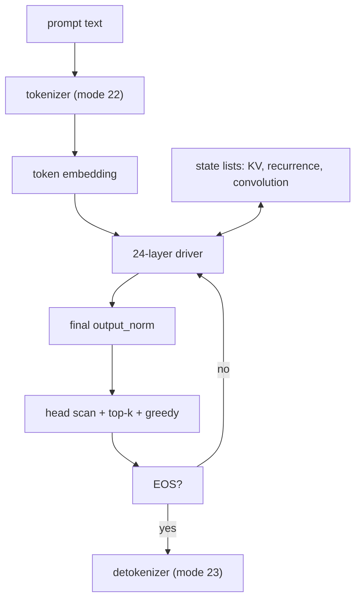
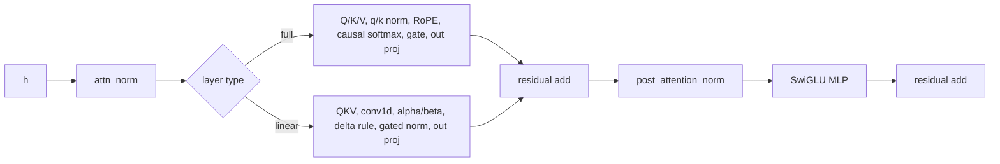
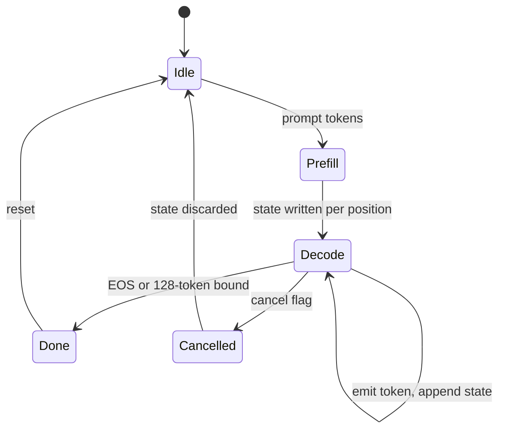

# BonsaiScratch M5-M8 Hybrid Decoder - Plan

## Goal Capsule

- **Objective:** a person can load the locked model package into the generated TurboWarp project, type a prompt, and receive generated text produced entirely by Scratch blocks, with per-layer, per-state, tokenizer, and decode evidence recorded against the pinned native reference on the test host.
- **Means:** extend the existing generated-project pipeline with the two missing layer families, a 24-layer decoder driver, and a Scratch text pipeline (KTD1-KTD8).
- **Authority:** `docs/bonsaiscratch-plan-v1.1.md` governs the numerical contract, execution boundary, and milestone exits; `docs/numerical-contract.md` governs tolerances; `docs/m3-decision.md` records the speed and kernel decisions this work builds on.
- **Execution profile:** one branch (`feat/bonsaiscratch-m0-m3` continues), one PR; no remote exists, so the work lands as a commit set on the branch.
- **Stop conditions:** if the pinned harness cannot capture a layer boundary the verification needs, stop before implementing that layer and record the gap rather than weakening the fixture. If a layer cannot meet its frozen tolerance after two corrective passes, stop and record the measured disagreement instead of loosening the contract. If decode exceeds the five-minute pause trigger with measured evidence, stop before the text pipeline and update the decision record.
- **Who finishes:** `ce-work` implements and commits; review, simplification, and residual recording follow in the same run.

## Product Contract

### Summary

Implement M5 through M8 of the governing plan: both layer types in Scratch blocks, the assembled 24-layer decoder, the text pipeline, and release validation. The existing project already produces correct M4 head output; this work supplies everything between the token embedding and that head.

### Problem Frame

The project can embed a token, transform and normalize activations, scan the full vocabulary head, and select a token, but it cannot produce a second token. Everything a decoder needs between those points — attention, recurrence, per-layer state, and the tokenizer — is absent, so the current artifact is a collection of verified kernels rather than a usable generator.

### Requirements

Layer numerics

- R1. The pinned harness emits deterministic per-layer fixtures for a fixed token-ID prompt at positions 1, 2, 16, and 64: layer inputs and outputs, attention intermediates, KV contents, DeltaNet convolution and recurrent state, and per-layer MLP outputs, each with build, model, seed, and position provenance.
- R2. The generated Scratch project computes one full-attention layer that agrees with the R1 fixtures within the frozen tolerances.
- R3. The generated Scratch project computes one Gated DeltaNet layer, including its convolution history and recurrent state, that agrees with the R1 fixtures within the frozen tolerances.

Decoder

- R4. The generated Scratch project runs all 24 layers in the locked schedule and produces the native next token for at least ten fixed token-ID fixtures, including one near-tie case.
- R5. Successive decode steps preserve recurrent, convolution, and KV state, and reproduce the native next tokens for a multi-token prompt.
- R6. Decoder state resets deterministically and generation stops at the 128-token bound or EOS 248046.

Text

- R7. The Scratch tokenizer reproduces the native token IDs for the locked chat template across the plan's fixture classes: leading spaces, CRLF, case changes, combining marks, CJK, emoji, and literal special-token text.
- R8. The Scratch detokenizer streams bytes across token boundaries and reconstructs the expected text without breaking UTF-8 sequences.

Evidence and release

- R9. Full decode latency, time to first token, peak memory, worst event-loop gap, and cancellation latency are measured at the production configuration and recorded in `benchmarks/results/` and `docs/m3-decision.md`.
- R10. The release set — generated `.sb3`, generator sources, loader source and hash, package tooling, compact fixtures, raw results, setup instructions, and limitations — is reproducible from a clean checkout plus the documented external downloads.

### Key Decisions

- **KD1. The deployed project performs all model math in Scratch blocks.** (see origin: docs/bonsaiscratch-plan-v1.1.md) Governs R2, R3, R4, R7, R8.
- **KD2. TurboWarp is the runtime; the Scratch website is not a target for this work.** The custom extension and list sizes are incompatible with scratch.mit.edu. Governs R10.
- **KD3. Publishing destination stays undecided.** The plan ends at reproducible local release artifacts; the packager output and any hosting choice are deferred. Governs R10.

### Scope Boundaries

In scope:

- Both layer families, the 24-layer driver, state lifecycle, tokenizer, detokenizer, and the generation loop.
- Fixture capture, benchmarks, documentation, and release reproducibility for those pieces.

Deferred for later:

- Publishing the project as a shared web artifact and choosing a host for it (KD3).
- Sampling, vision, and context beyond 128 tokens.
- Performance work beyond what the five-minute pause trigger requires.

Outside this product's identity:

- Moving model math into JavaScript, a server, or a native runtime.
- Patching the TurboWarp VM source.

### Outstanding Questions

None blocking. The capture capability for per-layer boundaries is verified in U1 before any layer work depends on it.

## Planning Contract

### Key Technical Decisions

- KTD1. **Per-layer fixtures come from the pinned harness graph capture, and large state artifacts stay outside Git.** Compact vectors (layer inputs/outputs, attention intermediates) are committed with checksums; recurrent and KV state are regenerated by a documented command and validated by checksum plus probe slices. Rejected committing multi-megabyte state per layer, because it breaks the compact-fixture policy without adding reviewable information.
- KTD2. **Tokenizer tables reach Scratch through a new string-array transfer block.** The extension copies a metadata string array into an existing list unchanged, matching the storage-only contract. Rejected embedding 248,320 token strings and 150,000 merge strings in `project.json`, which would inflate the artifact and duplicate package data.
- KTD3. **RoPE is partial: 64 of each 256-wide head dimension, base 1e7.** Scratch's degree trig runs through the existing mode-10 conversion, with F32 rounding at the contract's boundaries. Rejected full-head rotation, which the manifest's `rope.dimension_count` excludes.
- KTD4. **Attention uses 8 query heads and 2 KV heads at width 256 with a two-pass causal softmax.** Pass one finds the maximum, pass two accumulates exponentials and the normalizer, so each position is read twice rather than buffered. Rejected an online single-pass softmax, which needs running state per position and complicates the F32 boundary.
- KTD5. **DeltaNet state is one flat Stage list per layer with a circular convolution buffer.** Index arithmetic replaces nested lists, matching the existing list-dense design. Rejected per-head lists, which multiply block count without reducing work.
- KTD6. **One driver serves prefill and decode; the existing non-warp tile loop and 640-row tiles are retained.** A prefill step writes the position's KV or recurrence and a decode step reads it, so both share one code path. Rejected a separate batched prefill, which the plan's linear-in-tokens cost model does not reward.
- KTD7. **BPE ranking uses a sorted pair-rank list with binary search.** Rank pairs are emitted by the packer in rank order; each merge costs logarithmic comparisons instead of a linear scan over 150,000 entries. Rejected a linear scan, which is quadratic per word.
- KTD8. **Detokenization streams bytes through the existing costume-based code-unit lookup.** Long tokens are emitted as their byte sequence, with incomplete UTF-8 sequences held until the next token. Rejected building a new string engine.

- KTD9. **Every mode body lives in its own procedure.** An inlined body pushes the main script past the size where TurboWarp compiles it, and the whole script then runs interpreted: with mode 40 inlined, one head tile took 0.362 s instead of 0.194 s and head-scan cancellation took 317 ms instead of 121 ms against a 250 ms bound. Moving the body into `BS layer` restored 128 ms with byte-identical head code. Governs U4–U7: add a procedure, never an inline branch, for each new mode body.

### High-Level Technical Design



Layer internals, shared by both families:



Decoder lifecycle:



### Assumptions

- The graph-callback capture used for M4 can select the per-layer nodes R1 needs. U1 verifies this before any dependent unit starts.
- Native full-vector logits remain available by regenerating them, as the M4 work demonstrated, so R4 does not need a committed 993 KB vector.
- The locked tokenizer metadata is complete in the GGUF; inspection confirms `tokenizer.ggml.tokens`, merges, pre-tokenizer, and chat template are present.

## Implementation Units

### U1. Capture per-layer and per-state native fixtures

- **Goal:** the harness emits deterministic layer fixtures at positions 1, 2, 16, and 64 for one DeltaNet layer and one full-attention layer, and for the assembled decoder's per-layer outputs.
- **Requirements:** R1
- **Dependencies:** none
- **Files:** `tools/reference/reference.py`, `tools/reference/native.cpp`, `tools/reference/CMakeLists.txt`, `fixtures/native/m5/manifest.json`, `tests/test_reference.py`, `docs/numerical-contract.md`
- **Approach:**
  - Add a `layer` subcommand mirroring `m4`: fixed token IDs, explicit positions, and capture filters for `attn_norm`, post-attention residual, `attn_output`, `ffn_*`, and the final logits.
  - Serialize KV contents and DeltaNet recurrent state behind an explicit flag; write them outside the repository with a checksum manifest, and commit only probe slices.
  - Record the build hash, model identity, seed, context, positions, and tensor identities per the existing fixture schema.
- **Patterns to follow:** `reference.py` `m4` fixture assembly and `fixtures/native/m4/head/manifest.json` provenance fields.
- **Test scenarios:**
  - Repeated capture of the same tokens and positions yields identical checksums.
  - A capture with an unsupported node name reports a missing-capture error rather than an empty fixture.
  - The committed manifest's probe slices match the regenerated state file.
  - Requesting position 64 with a shorter context fails loudly instead of truncating.
- **Verification:** the manifest lists every captured boundary for both layer types with provenance, and the regeneration command in `docs/numerical-contract.md` reproduces the checksums.

### U2. Transfer tokenizer tables into Scratch lists

- **Goal:** a project can populate its token and merge lists from the selected package without any model math leaving the extension's I/O role.
- **Requirements:** R7
- **Dependencies:** none
- **Files:** `extension/loader.js`, `tools/package_model.py`, `docs/model-format.md`, `docs/extension.md`, `tests/transport/loader.test.js`, `tests/transport/bounds.test.js`
- **Approach:**
  - Add a string-array transfer block that copies a named metadata array into a destination list, retaining the list object and reporting copied counts and status like the dense block.
  - Extend the package with the tokenizer arrays the plan needs, recorded in the manifest with counts and checksums.
  - Keep the block storage-only: no decoding, ranking, or string transformation.
- **Patterns to follow:** `extension/loader.js` `loadDense` status/copy/ownership handling.
- **Test scenarios:**
  - Copying a 248,320-entry array completes with the exact count and preserves order at the first, middle, and last entries.
  - A missing metadata key reports `error` and leaves the destination untouched.
  - A destination list owned by another request fails closed.
  - Cancellation before copy publishes nothing.
- **Verification:** a compiled-VM run loads the token array and reads three known token strings by index.

### U3. Layer primitives in Scratch

- **Goal:** the reusable block procedures both layer families need exist and are individually verified.
- **Requirements:** R2, R3
- **Dependencies:** U1
- **Files:** `scratch/layers.py`, `tools/generate_project.py`, `tests/scratch/test_layers.py`
- **Approach:**
  - Implement weighted RMSNorm, partial RoPE, two-pass causal softmax, SiLU gating, residual accumulation, and per-head gated norm as procedures over the existing variable/list helpers.
  - Apply F32 rounding at the same boundaries the contract names for norm and transform outputs.
- **Patterns to follow:** `scratch/numeric.py` mode 5 RMS norm and `scratch/transform.py` F32-rounded writes.
- **Test scenarios:**
  - Weighted RMSNorm matches a fixture vector within 1e-6 absolute.
  - Partial RoPE rotates the first 64 dimensions and leaves the remaining 192 unchanged.
  - Causal softmax over one position returns 1.0; over three positions matches hand-computed weights.
  - Softmax with a single maximum shifted by a large constant returns the same weights.
  - SiLU gating matches the fixture for a mixed-sign vector.
- **Verification:** primitive fixtures from U1 pass in the compiled VM with the loader disabled after the inputs load.

### U4. Full-attention layer

- **Goal:** the project computes one complete full-attention layer in Scratch that matches the native layer boundary.
- **Requirements:** R2
- **Dependencies:** U1, U3
- **Files:** `scratch/layers.py`, `tools/generate_project.py`, `tests/scratch/test_layers.py`, `docs/numerical-contract.md`
- **Approach:**
  - Project Q with its 2,048 gate channels, K and V at 512 each, normalize q and k per head, apply partial RoPE, mask causally, gate the attention output, project out, add the residual, norm, run SwiGLU, and add the second residual.
  - Freeze the layer tolerance from the fixture before any optimization.
- **Test scenarios:**
  - Single-position input reproduces the fixture's attention output within the frozen tolerance.
  - Position 64 with 64 prior positions reproduces the fixture, proving the mask and cache path.
  - A query head whose gate channel is negative flips the output sign relative to the ungated value.
  - KV contents after the layer match the fixture probes.
  - A zero-length cache returns `invalid dimensions`.
- **Verification:** the compiled VM matches both positions 1 and 64 fixtures for `blk.3` and records maximum absolute and RMS error.

### U5. Gated DeltaNet layer

- **Goal:** the project computes one complete linear-attention layer, including convolution history and recurrent state, that matches the native layer boundary.
- **Requirements:** R3
- **Dependencies:** U1, U3
- **Files:** `scratch/layers.py`, `tools/generate_project.py`, `tests/scratch/test_layers.py`, `docs/numerical-contract.md`
- **Approach:**
  - Project fused Q/K/V, run the depthwise kernel-4 convolution over the circular buffer, derive alpha and beta from the F32 projections, apply the delta rule to the per-head 128×128 state, apply the gated norm, gate, project out, then the residual, post-attention norm, and MLP.
  - Store state in the flat per-layer list KTD5 defines.
- **Test scenarios:**
  - Position 1 reproduces the fixture with an empty history.
  - Position 2 proves the convolution reads the previous token's history in the correct order.
  - Position 16 reproduces the fixture recurrent state probes.
  - Resetting the layer returns the state list to its initial values.
  - A state list of the wrong length reports `invalid dimensions`.
- **Verification:** the compiled VM matches positions 1, 2, and 16 for `blk.0`, with state probes matching the regenerated artifact.

### U5 status note (in progress)

U4 is complete: mode 40 reproduces `l_out-3` at positions 1 and 64 to ~1e-7 and position 2 to 6.5e-5, with the frozen tolerance 1e-4 max / 2e-5 RMS (`tests/scratch/test_attention.py`).

The DeltaNet recurrence is a *fused* kernel (`ggml_compute_forward_gated_delta_net_one_chunk`, `ggml/src/ggml-cpu/ops.cpp`), so the graph captures only its inputs and outputs. The per-token, per-head step (S_v = 128) is:

- `beta = sigmoid(beta_raw)`, `g0 = ssm_a[h] * softplus(alpha_raw + ssm_dt_bias[h])`, decay `= exp(g0)`;
- state is stored transposed, `M[j*128 + i] = S[i][j]`;
- `M[j*128 + i] *= decay` for every `i`;
- `delta[j] = (v[j] - dot(M row j, k)) * beta`;
- `M[j*128 + i] += delta[j] * k[i]`;
- `attn[j] = dot(M row j, q) * (1/sqrt(128))`.

`q` and `k` are the L2-normalized convolution outputs (`qk_conv_l2`), `v` the raw convolution output. Outputs feed the gated RMS norm (`ssm_norm`, SiLU gate) and `ssm_out`. Fixture anchors per position: `conv_output_raw`, `conv_output_silu`, `qk_conv_l2`, `alpha`, `beta`, `new_state`, `final_output`, `linear_attn_out`, `l_out-0`, with the convolution history captured post-copy. State seeding follows the attention layer: token-major Scratch cells, native V/D state converted on load.

### U6 status note (blocked, recorded per the stop rule)

Both layer families are verified individually through the captured chain at position 1 (layers 0, 1, 2 and 3 within 3.6e-7), the layer procedures build their tensor names from `BS layer`, and state/KV are addressed through `BS state base` / `BS kv base`.

The driver loop does not yet work. Calling a layer procedure a second time inside one script appends exactly one `invalid dimensions` item to `BS output` on top of the previous result: the layer's own 2048 values are correct and match the native boundary, but the list ends at 2049, so the next layer's `length == 2048` guard fails and every remaining layer bails instantly (a 24-layer pass finished in 5.7 s, versus ~1.5 s for layer 0 alone).

Corrective passes already tried without changing the symptom:
- waiting for loader refills in `load_dense` before checking status;
- handing the layer result off in place instead of copying in the driver;
- copying `BS output` into `BS input` between calls (the copy itself is verified: the marker right after it reads 2048).

Evidence that the guard and nested calls work: a single call leaves the input at 6144 (the last intermediate, as expected), a one-element input makes the guard append the measured length `1`, and the first 2048 values of the second call match `l_out-0` exactly. So the extra item is appended to `BS output` by a block that runs after the layer's publish, not by the guard.

Next probe: instrument `scratch/deltanet.py` so every branch that appends to `BS output` or `l_output` also appends its own tag, then run call→copy→call and read the tag sequence.

### U6. 24-layer decoder

- **Goal:** the project produces the native next token from fixed token IDs across the locked layer schedule.
- **Requirements:** R4, R5, R6
- **Dependencies:** U2, U4, U5
- **Files:** `scratch/decoder.py`, `tools/generate_project.py`, `tests/scratch/test_decoder.py`, `docs/m3-decision.md`
- **Approach:**
  - Dispatch the 18 DeltaNet and 6 full-attention layers from the manifest order, share one prefill/decode step (KTD6), and expose reset, progress, and cancellation.
  - Keep the existing head scan and greedy selection as the final stage.
- **Test scenarios:**
  - Ten fixed token-ID fixtures produce the native next token.
  - The documented near-tie fixture records the margin and the tie rule's behavior.
  - Two successive decode steps reproduce the native second token.
  - Reset allows an identical rerun with identical output.
  - Generation stops at EOS and at the 128-token bound.
  - Cancellation mid-layer aborts within the measured bound without publishing a partial token.
- **Verification:** a compiled-VM run reproduces native next tokens for all fixtures and records latency, time to first token, memory, and gaps.

### U7 status note (design decision required)

U7's pre-tokenization step needs a Unicode-aware regex. The locked model's `tokenizer.ggml.pre` is `qwen35`, whose rule in the pinned `llama-vocab.cpp` is:

```
(?:'[sS]|'[tT]|'[rR][eE]|'[vV][eE]|'[mM]|'[lL][lL]|'[dD])|[^\r\n\p{L}\p{N}]?[\p{L}\p{M}]+|\p{N}| ?[^\s\p{L}\p{M}\p{N}]+[\r\n]*|\s*[\r\n]+|\s+(?!\S)|\s+
```

It uses Unicode general categories (`\p{L}`, `\p{M}`, `\p{N}`) and a negative lookahead. The package carries the token and merge arrays but no character-category table, and the storage extension may not compute anything (contract: select files, read metadata, copy values only). Reproducing this rule therefore needs either a packaged Unicode category table plus a hand-written scanner in Scratch, or a narrowed tokenizer whose divergence is documented per fixture class.

Two further constraints measured so far: Scratch string equality is case-insensitive, which is why the existing text primitives resolve characters through 256 costume-lookup sprites and a broadcast per code unit (58.5 s for the current no-renderer proof run), and Scratch does not execute a warp procedure call inside a `repeat`, so the generation loop has to be driven one script run per token (the harness does this today; a Scratch-side loop would need broadcast hats).

Resolved without touching the package format or the extension: the generator embeds a run-length Unicode category table (built from Python's `unicodedata`) directly in the generated project as a list, and the Scratch pre-tokenizer scans the prompt against it. This keeps the package lossless as-is and the extension storage-only.

### U7. Scratch tokenizer, detokenizer, and generation loop

- **Goal:** a person can type text and receive generated text with no host involvement in tokenization, decoding, or selection.
- **Requirements:** R7, R8
- **Dependencies:** U2, U6
- **Files:** `scratch/text.py`, `tools/generate_project.py`, `tests/scratch/test_text_pipeline.py`, `README.md`
- **Approach:**
  - Apply the `qwen35` pre-tokenization rules, then byte-level BPE using the sorted pair-rank list with binary search (KTD7), then the locked chat template.
  - Detokenize by streaming token bytes with incomplete sequences held (KTD8); stop on EOS.
- **Test scenarios:**
  - Leading-space, CRLF, case-change, combining-mark, CJK, and emoji prompts produce the native token IDs.
  - Literal `<|im_end|>` text is tokenized as text, not as the special token.
  - A multi-byte token split across two tokens is emitted as valid UTF-8 once complete.
  - Generation stops at EOS and produces the expected text bytes for a fixed fixture.
  - An empty prompt reports a clear status rather than hanging.
- **Verification:** a compiled-VM run produces the expected token IDs and reconstructed text for every fixture class.
- **Status:** implemented. `scratch/tokenizer.py` scans with the pinned runtime's own splitter, merges over the packed `prism.bpe.*` tables, and detokenizes through the loaded vocabulary and an embedded 65,536-unit table. `tests/scratch/test_tokenizer.py` passes in the compiled VM: ten fixture classes reproduce the pinned ids exactly, and `[424,579,220,109266,26594]` renders as ` it's 你好 🙂`. A two-token run from `hello world` yields tokens 0,0 and the text `hello world!!`. Measured here: about 45 s for a prompt including the one-time table loads, and about 35 s per decode step. Still open from this unit: EOS handling defaults to `<|im_end|>` (248046) and has not been exercised; a multi-byte character split across two *tokens* (KTD8) is only covered by whole-piece rendering, since pieces carry whole characters in this vocabulary; empty prompts return an empty token list rather than a status message; and the locked chat template is not applied before the prompt.

### U8. Release validation and documentation

- **Goal:** the release set is reproducible, independently inspectable, and carries measured evidence.
- **Requirements:** R9, R10
- **Dependencies:** U6, U7
- **Files:** `README.md`, `docs/numerical-contract.md`, `docs/model-format.md`, `docs/extension.md`, `docs/m3-decision.md`, `benchmarks/decoder.py`, `benchmarks/results/decoder-xeon.json`, `dist/`
- **Approach:**
  - Add a decoder benchmark that records prompts, timings, memory, gaps, and cancellation at the production configuration, and refresh the decision record from it.
  - Regenerate the released artifacts and verify their hashes and reproducibility.
- **Test scenarios:**
  - Regenerating `dist/fp16-q8-scalar.sb3` from a clean tree reproduces the recorded hash.
  - The benchmark rejects a run whose output token differs from the fixture.
  - Documentation commands run as written from the repository root.
- **Verification:** the decision record states the measured decode, time to first token, memory, and limitations, and every release artifact is reproducible.

## Verification Contract

| Check | Command | Applies to |
|---|---|---|
| Transport and loader | `node --test tests/transport/*.test.js` | U2 |
| Reference fixtures and native tools | `python3 -m unittest tests.test_reference -v` with `BONSAI_NATIVE_BUILD` and `BONSAI_MODEL_PATH` set | U1 |
| Scratch primitives and layers | `python3 -m unittest discover -s tests/scratch -p 'test_layers.py' -v` with `BONSAI_TURBOWARP_VM` and `BONSAI_MODEL_PACKAGE` set | U3, U4, U5 |
| Decoder | `python3 -m unittest discover -s tests/scratch -p 'test_decoder.py' -v` with the same variables plus `BONSAI_NATIVE_MANIFEST` and `BONSAI_NATIVE_LOGITS` | U6 |
| Text pipeline | `python3 -m unittest discover -s tests/scratch -p 'test_text_pipeline.py' -v` | U7 |
| Full suite | `python3 -m unittest discover -s tests -v` and `node --test tests/transport/*.test.js` | U8 |
| Reproducibility | regenerate `dist/fp16-q8-scalar.sb3` and compare the recorded hash | U8 |

Compiled-VM tests require the pinned TurboWarp checkout and a package built from the locked model; they are the only evidence accepted for layer, decoder, and text correctness.

## Definition of Done

- R1 through R10 are each demonstrated by a committed test or recorded measurement.
- Every feature-bearing unit's test scenarios exist and pass in the compiled VM, or the unit records the measured gap instead of claiming success.
- Per-layer and per-state tolerances are frozen in `docs/numerical-contract.md` before any performance work.
- The decision record states measured decode, time to first token, memory, and the host-only limitation; no target-hardware claim is made.
- Abandoned experimental code from rejected approaches is removed from the diff.
- The release set is reproducible, and the documentation commands work as written.
