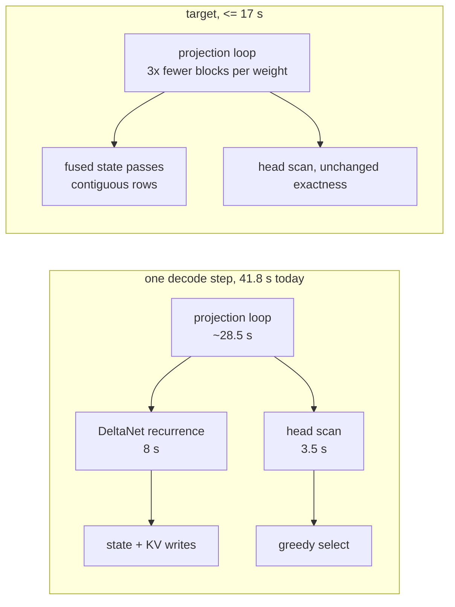

# Scratch decode throughput - Plan

## Goal Capsule

- **Objective:** the prompt-to-text project keeps producing exactly the pinned runtime's tokens while spending substantially less time doing it — a decode step at or below 17 s against today's measured 41.8 s, and a first token at or below 600 s for the ten-token release prompt against today's 723.8 s, both measured by an interleaved protocol on the recorded host.
- **Means:** measure the real cost split first, close the silent-failure and list-hygiene gaps that would make a faster kernel lie, then three measured changes in order of payoff — the projection hot loop (KTD1), the DeltaNet pass fusion (KTD3), and batched prompt prefill (KTD4) — each gated on unchanged output tokens.
- **Authority:** `docs/numerical-contract.md` governs tolerances and must not loosen; `docs/bonsaiscratch-plan-v1.1.md` governs the execution boundary and the memory gate (stay below 6 GB, stop and redesign above 8 GB); `benchmarks/results/` and the decode harnesses are the measurement authority; `docs/m3-decision.md` records the decisions this plan revises.
- **Execution profile:** one branch, four PR groups. Group 1 lands measurement plus correctness guards, group 2 the kernel loop, group 3 the recurrence fusion, group 4 prompt batching and the release refresh. Group 3's measured claim depends on group 2's kernel, so it merges after it.
- **Stop conditions:** if the kernel rewrite cannot beat the 41.8 s baseline by at least 1.5× after two corrective passes, stop and record the measured ceiling instead of widening scope; if any frozen tolerance would have to loosen, stop; if a change moves the verified output token anywhere, revert it rather than adjusting the expectation; if measured peak memory crosses the plan's 8 GB redesign gate, stop before the text pipeline and update the decision record.
- **Who finishes:** an implementer executes U1-U7 and regenerates the release artifacts; the gates in the Verification Contract decide whether the result ships.

---

## Product Contract

### Summary

Make the working release fast enough to feel less like a batch job: keep the exact same text, cut the per-token cost by roughly 2.4× and the first-token cost by at least a fifth, with every number recorded next to the harness that produced it.

### Problem Frame

The project now produces native-matching text end to end, and it is slow: a decode step measured 41.8 s median (640-row tiles, two interleaved repetitions), a ten-token prompt took 723.8 s to its first token, and the Node VM peaked at 4.3-4.8 GiB. One step streams 1.88 G ternary weights (24 blocks at 58.8 M and 52.4 M plus a 508 M head), which at the VM's measured per-weight cost of about 22 ns accounts for 41.4 s — the measurement and the cost model agree, so the cost is understood and attackable.

Research into how real engines handle the same problem says the payoff is not where the obvious guess puts it. Batching prompt tokens amortizes only the weight-read share of the cost, about 44%, so prefill gains 1.3-1.5×, not the order of magnitude a "ten tokens in one pass" intuition suggests (KTD4). The chunked gated-delta-rule form that flash-linear-attention implements adds about 83% arithmetic at this sequence length and exists to parallelize training, not to cut inference work (KTD3). The largest measured-shaped gap is inside the hot loop: it costs roughly eight blocks per 128-weight group where three suffice, so the same weights could be applied in about a third of the time (KTD1). The recurrence is next: 8 s for state work whose real cost is four operator expressions per element plus three separate 128-value passes, not the layout (KTD3).

Three defects would make a faster kernel produce confident nonsense: a failed or rejected weight tile is invisible to the layer and the decoder; failure sentinels are written as strings into numeric lists, which boxes them for the rest of the session; and the throughput harness cannot yet separate build cost from runtime cost or observe the late-token attention positions (U1, U2). All are cheaper to fix before the kernel changes than after.

### Requirements

**Correctness preservation**

- R1. Every change keeps the verified output identical: the decoder fixture token, the ten-fixture decode matrix, the head fixture, and the three release prompts' generated ids and rendered text must match their recorded native expectations after each unit.
- R2. Frozen tolerances in `docs/numerical-contract.md` are unchanged; a change that would need a looser tolerance is reverted, not re-baselined.
- R3. Failure is signalled through variables (`BS proj valid`, `BS stop reason`), never by writing a sentinel string into a numeric list on the decode or prefill path, because one string write deoptimises every later read of that list.

**Throughput**

- R4. A decode step measured by `benchmarks/decode.py` at the production configuration is at or below 17 s median, using the interleaved protocol in KTD8 so host contention cannot manufacture the result.
- R5. Time to first token for the ten-token release prompt measured by `benchmarks/decoder.py` is at or below 600 s.
- R6. Prompt processing takes at most one weight pass per batch of K prompt tokens, where K is the largest batch the KV cache, the step budget and the prompt allow; the release prompt (ten tokens) is therefore a single pass.
- R7. Peak memory stays inside the project's memory gate — below 6 GB, with 8 GB as the redesign-and-stop threshold — measured per run rather than inherited from a monotonic high-water mark.

**Observability**

- R8. Each unit records, beside its harness output, the measured ns per weight, the stage split, compile time, per-run peak RSS, and the project and generator hashes, so a later reader can tell a real gain from a host artefact.

**Reproducibility**

- R9. The release stays reproducible from the documented external inputs: regenerated `.sb3` files match `fixtures/artifact-checksums.json`, packages match `fixtures/package-checksums.json`, and the full suite plus transport tests pass.

### Key Decisions

- **Exactness is not traded for speed.** No approximate top-k, no pruning that can change the chosen token, no reduced-precision path that moves a tolerance. Governs R1, R2. (session-settled: user-approved — chosen over approximate acceleration: the release's value is that it matches the pinned runtime.)
- **The package may gain derived tensors and be repacked.** Fused or reordered views and lookup companions are allowed when measured to help, with refreshed checksums. Governs R9. (session-settled: user-approved — chosen over keeping the package byte-identical: locality is one of the few levers left.)
- **The extension may reshape bytes while copying, never compute.** Layout transforms at copy time are in scope; arithmetic on model values is not. Governs R9. (session-settled: user-approved — chosen over a pure copier: the boundary is model math, not byte movement.)
- **Ordering follows measured payoff, not the earlier guess.** The plan was scoped with prompt batching first on the assumption it could be an order-of-magnitude win; measurement and research put it at 1.3-1.5×, so the kernel loop and recurrence fusion lead and batching follows. Governs R4, R5, R6. This supersedes the sequencing stated at scoping.

### Success Criteria

- The benchmark table shows a decode step at or below 17 s and a first token at or below 600 s under the interleaved protocol, with identical token output.
- The full suite and the transport tests pass, and both shipped `.sb3` hashes regenerate.
- A later reader can reconstruct why each change was kept or dropped from `benchmarks/results/` without reading the code.

### Scope Boundaries

- **Outside this product's identity:** moving model arithmetic into JavaScript, or running the model anywhere other than Scratch blocks; anything that changes the locked model, its pinned runtime revision, or the tolerances.
- **Considered and not built:** a projection-tile byte-cap clamp (the shipped 640-row tile is 30,720 of 123,361 groups, and the extension already rejects an over-cap request loudly through U2's failure path; revisit only with a larger tile); chunked gated-delta-rule prefill (adds arithmetic at this length for parallelism a single-threaded interpreter cannot use); paged KV cache (the cache is 128 cells and already contiguous); prefill/decode disaggregation (there is one VM); a half-group unroll as a compile-time fallback (only if U3 measures compile time dominating).
- **Deferred to Follow-Up Work:** browser-renderer memory measurement; a second host measurement for portability; multi-token speculative decoding.

---

## Planning Contract

### Key Technical Decisions

- KTD1. **Collapse the projection hot loop to one packed read, one lookup and one add per group byte.** Today the loop pays two index increments and a loop counter per byte on top of the arithmetic. Unrolling the group's bytes into straight-line blocks with absolute list indices, and hoisting the scale multiply per group, removes that overhead without touching the accumulation order (the three per-group F32 roundings stay exactly where they are, so no tolerance moves). The unroll length and LUT domain are codec-derived through `lut.codec_tables` (32/26 groups, 256/81/243 domains across raw, bslut4 and bslut5), so the body is generated per codec, not hard-coded at 32. Research floor: about 5.8 ns per weight against today's 22.
- KTD2. **Keep every hot index type-provably numeric, and choose pre-sizing from measurement.** The compiled VM lowers `item of` to a raw array read only when the index is provably numeric, and one string written into a list turns every later read into a boxed element (R3). `replace item` measured 4.59 ns against 29.55 ns for `add to list`, but that figure came from a one-element list; U1 re-measures both on the real 2,048-wide and 248,320-row destinations before U3 adopts either. Deleting a list allocates a fresh packed array, so any pre-sized destination is cleared first.
- KTD3. **Fuse the per-token state passes; keep the existing transposed layout.** The state is already stored transposed and flat (`head*16384 + row*128 + col`, contiguous rows); the measured 8 s is index-expression cost, `*1`/`+0` no-ops and three separate 128-value passes per head, not a layout problem. Fuse the passes and hoist the arithmetic that does not depend on the inner index. The chunked form is rejected: it adds roughly 83% arithmetic at 128 tokens, and its parallelism is unusable in a single-threaded interpreter.
- KTD4. **Batch prompt tokens inside one weight pass, bounded by the KV cache, causality and the step budget.** Only the weight-read share amortizes (about 44%), so the expected gain is 1.3-1.5× on prompt time. The production batch is the largest `K = min(128 - context position, token budget - steps taken, prompt tokens remaining)`; there is no separate fixed cap — 8 is a test parameter, not the shipped value. The budget term is a count of remaining decode steps, not a cell limit. `BS step` advances by the batch, attention writes its K cells only after the scan so causality holds, and the readout gate becomes per-slot. Projections batch; the convolution shift, the delta recurrence and the per-token gates stay serial.
- KTD5. **Rely on the loader's cap plus the failure path instead of adding a clamp.** The cap is 123,361 groups (34 bytes each); at the shipped 640-row tile that is 30,720 groups at 48 groups per row, so the cap never binds, and the extension already rejects an over-cap request with `invalid range`. The mechanism a clamp would add is therefore considered and not built (Scope Boundaries); U2's failure path is what makes an over-cap request loud. If a future tile increase moves the configuration above the cap, the projection loop's iteration count must be derived from remaining rows rather than from the module `TILE` constant at the same time.

- KTD6. **Make a failed tile stop the step.** `BS proj valid` exists but only the layer's Q split reads it; the decoder and the delta stage ignore it, and greedy selection runs unconditionally, so a failed load silently decodes from the previous token. The step reports failure through variables (R3) and the generation loop records a failure stop reason instead of appending a token.
- KTD7. **Record build cost as well as runtime cost.** The harness times the whole node subprocess, so project load and compile sit inside the 17 s gate; the unroll adds roughly 190 blocks at three call sites (about 6% of the current block count), and the pinned compiler has no size cap, only compile-time cost. U1 records compile milliseconds and block/JSON size so a compile regression cannot hide inside a runtime win.
- KTD8. **Compare builds, not just configurations, with an interleaved protocol.** The recorded tile-640 pair spans 45.1 s and 38.4 s for the same build, so a single-number comparison is worthless and "median of two" is a mean. The protocol: materialize the baseline generator from a git revision into a temp directory, generate both projects before any stubbing, alternate them within each repetition, report per-pair deltas with at least three pairs, and record CPU seconds and worst event-loop gap as the discard test. Assert the produced token inside the timed run rather than only recording it.

### High-Level Technical Design



The prompt path is the same graph run once per token today. After U5 it runs once for the whole prompt for the projections, then a serial pass for the recurrence, one head pass, and per-token KV writes:

```mermaid
sequenceDiagram
  participant Loop as generation loop
  participant Proj as batched projections
  participant Rec as serial recurrence
  participant Head as head scan
  Loop->>Proj: K prompt tokens, one weight pass
  Proj->>Rec: per token, in order
  Rec->>Loop: KV cell per token
  Loop->>Head: once, on the last position
```

### Assumptions

- The measured 22 ns per weight and the stage split still hold after the U1 harness upgrade; if they do not, KTD1's target is re-derived before U3 starts.
- Fusing the state passes can preserve the exact accumulation order of each dot product; if a fixture shows drift, U4 keeps the current structure and records the result rather than relaxing R2.
- Batched prefill fits memory: K LUT sets cost at most 7.6 MiB at K = 8, and K accumulators plus K destinations are negligible against the measured peak; U5 confirms with per-run RSS.
- The pinned TurboWarp compiler accepts the larger procedures the unroll produces; if compile time dominates, the half-group unroll recorded in Scope Boundaries becomes the fallback.

### Risks & Dependencies

| Risk | Decision |
|---|---|
| Host contention makes a change look faster | Interleaved build-vs-build protocol with ≥3 pairs and a CPU/gap discard test (KTD8) |
| A compile-time regression hides inside the runtime win | Record compile milliseconds and block count per run (KTD7) |
| One string sentinel boxes a numeric list for the session | Failure via variables only (R3); pre-sized destinations cleared before writing |
| Batched prefill exhausts the token budget before the first token | Budget term is remaining decode steps (KTD4); a `max_tokens = 1` batched test is required in U7 |
| Early-position timing flatters the result | A late-position (~120) measurement is part of the decode gate, with its own seeding hook in U1 |
| The 17 s target has little slack if the recurrence lands above its floor | If two corrective passes cannot reach 17 s, ship the measured step with its per-stage table and record which stage missed, rather than relaxing R1-R3 |
| Memory growth is invisible behind a monotonic RSS watermark | Per-run peak RSS from the child process, recorded in the ledger (R7) |

### Sequencing

Group 1 must land before any kernel change: it establishes the cost split, the failure path and the measurement protocol the later units are judged by. Group 2 rewrites the projection helper; group 3's recurrence-share measurement is only attributable against that kernel, so it merges after group 2 rather than in parallel. Group 4 multiplies whatever the projection kernel costs and ends with the release refresh so the shipped artifacts match the measured state.

---

## Implementation Units

### PR1: Measure, then make failure visible

Waits on: nothing.

### U1. Cost-model harness upgrade

- **Goal:** turn the decode harness into the instrument every later unit is judged by: per-matrix ns per weight, stage shares, compile time, per-run peak RSS, and a build-vs-build interleaved protocol.
- **Requirements:** R8, KTD7, KTD8
- **Dependencies:** none
- **Files:** `benchmarks/decode.py`, `benchmarks/lists.py`, `benchmarks/decoder.py`, `tests/scratch/run-vm.js`, `benchmarks/results/`
- **Approach:**
  1. Add a per-matrix ledger (tensor, rows, weights, wall, ns per weight) around the projection path, plus a per-stage split that reuses the existing stub mechanism.
  2. Record compile milliseconds from the harness's existing `tryCompile` wrapper and the project's block/JSON size; include the weights column sum check so the ledger proves it covers the model.
  3. Emit per-run peak RSS from the child process, and fix `decoder.py`'s monotonic `RUSAGE_CHILDREN` high-water mark so each prompt's peak is separable. Merge the benchmark fields into the debug-vars output instead of enabling `BONSAI_BENCHMARK`, which currently pre-empts it and nulls the token field.
  4. Add a build-vs-build mode: generate the baseline project from a git revision into a temp directory, generate both projects before applying stubs, alternate them inside each repetition, and report per-pair deltas.
  5. Re-measure append versus replace on a 2,048-element destination and on the 248,320-row head destination, in `benchmarks/lists.py`, which already has the phases.
  6. Add a `--position N` mode that seeds the KV lists with N cells through a new harness hook and records a separate result file, so the late-position figure is measurable rather than aspirational.
  7. Isolate the baseline generator import: both trees export the top-level `scratch` package, so the baseline must be generated in its own interpreter subprocess (or with explicit `sys.path`/`sys.modules` handling), otherwise the "baseline" project is generated from the current tree and every per-pair delta reads as zero.
- **Patterns to follow:** the record shape in `benchmarks/results/list-ops-xeon.json` and `decode-tiles-controlled.json`.
- **Test scenarios:**
  - A ledger run sums to the model's 1.88 G weights within rounding.
  - A run with `--stub head` attributes cost to the head row and leaves projection rows unchanged.
  - The pre-sizing benchmark reports distinct append and replace costs for a 2,048-element list and for a 248,320-row list.
  - Three interleaved pairs produce three per-pair deltas and one summary, with no overwritten result.
  - A timed run asserts the produced token rather than only recording it.
  - A baseline generated from a pinned revision has a different project hash from the current build, proving the two trees were actually separated.
  - A `--position 120` run reports its own result file with the seeded KV length recorded.
- **Verification:** a ledger exists whose shares match the recorded ablation within a few percent; compile time and per-run RSS are recorded; the pre-sizing question has a measured answer on both list sizes.

### U2. Step-level failure path and numeric-list hygiene

- **Goal:** a rejected or failed tile can no longer be mistaken for a successful decode, and no failure path writes a string into a numeric list.
- **Requirements:** R3, R1, KTD5, KTD6
- **Dependencies:** U1
- **Files:** `scratch/attention.py`, `scratch/deltanet.py`, `scratch/decoder.py`, `scratch/tokenizer.py`, `scratch/layers.py`, `scratch/embedding.py`, `tools/generate_project.py`, `tests/scratch/test_failure_path.py`
- **Approach:** propagate `BS proj valid` from the projection helper into its caller; the decoder marks the step invalid and skips greedy selection; the generation loop records a failure stop reason. Replace the string sentinels on the decode/prefill path (`'invalid dimensions'`, `'nonfinite'`, `'error'`, `'load failed'`) with variable-and-stop-reason signalling on that path, keeping the diagnostic modes' behaviour intact because their tests assert the sentinel. Leave the tile at its shipped 640 rows (KTD5 explains why no clamp is added).
- **Execution note:** Add the failing-tile test first — the point of this unit is that the failure is observable, so prove the test catches the current silent behaviour before changing the path.
- **Test scenarios:**
  - With `loadGroups` stubbed to reject, a decode step reports failure, produces no token, and the loop records a failure stop reason instead of rendering a stale token.
  - A projection call that the loader rejects (an over-cap request) aborts the step through the failure path rather than scanning a short matrix.
  - After a failed step, the numeric lists that fed it contain no strings.
  - A successful step still produces fixture token 11 and all 248,320 logits.
- **Verification:** the stubbed-failure test fails against the pre-change build and passes after; the boundary test passes; the fixture token is unchanged; no string appears in a destination list after a failure.

### PR2: Projection hot loop

Waits on: PR1 merge.

### U3. Collapse the projection inner loop

- **Goal:** apply the same weights with roughly a third of the per-weight blocks, so the projection share of a step falls by the measured factor.
- **Requirements:** R1, R2, R4
- **Dependencies:** U1, U2
- **Files:** `scratch/lut.py`, `scratch/attention.py`, `benchmarks/decode.py`, `tests/scratch/test_projection_kernel.py`, `tests/scratch/test_attention.py`, `tests/scratch/test_deltanet.py`, `tests/scratch/test_head.py`
- **Approach:**
  1. Add an unrolled variant of the group body generated per codec from `lut.codec_tables`: straight-line steps with absolute packed-byte and LUT-slot indices, one scale multiply per group, and the same three F32 roundings in the same order.
  2. Adopt pre-sizing plus `replace item` only where U1's measured answer says it beats append on that destination size; clear a pre-sized destination first.
  3. Keep every index type-provable numeric; no strings and no `mod` in the inner path.
  4. Route the projection helper and the head's row loop through the same body. The delta stage's dense F32 rows are a different loop and stay out of this unit.
- **Execution note:** The numerical contract is the risk here, not the speed: prove unchanged output on the existing fixtures before recording any timing.
- **Test scenarios:**
  - `tests/scratch/test_attention.py` layer fixture and `tests/scratch/test_deltanet.py` fixtures reproduce their recorded maximum-absolute and RMS errors unchanged.
  - `tests/scratch/test_head.py` still returns 248,320 logits with the same top-8 order, the same greedy token, and the same cancellation bound.
  - `tests/scratch/test_projection_kernel.py`: each codec (raw, bslut4, bslut5) produces identical output to the previous implementation through the diagnostic modes, since unroll length and LUT domain differ per codec.
  - A 6,144-row matrix at tile 640 fills the destination to exactly 6,144 numeric entries, each row scanned once.
  - A 48-group call at the 2,570-row clamp boundary succeeds.
  - The harness records ns per weight before and after in the same run, and compile time stays within the recorded budget.
- **Verification:** unchanged fixtures plus a recorded ns-per-weight improvement and a recorded compile time; the interleaved median shows the step below the baseline by the measured factor.

### PR3: Recurrence fusion

Waits on: PR2 merge (U4's recurrence-share measurement runs against the U3 kernel, so it merges after group 2).

### U4. Fuse the DeltaNet per-token passes

- **Goal:** cut the DeltaNet recurrence share from its measured 8 s toward the flat-read floor by removing index-expression overhead and fusing the per-token passes, without changing the state layout.
- **Requirements:** R1, R2, R4
- **Dependencies:** U1, U2, U3
- **Files:** `scratch/deltanet.py`, `tests/scratch/test_state_layout.py`, `tests/scratch/test_deltanet.py`, `benchmarks/decode.py`
- **Approach:** keep the transposed flat layout (`head*16384 + row*128 + col`); hoist the base-offset arithmetic out of the inner loops, drop `*1`/`+0` no-ops, and fuse the decay, delta, rank-1 update and query passes so each row is walked once with one pointer; keep the arithmetic order inside each dot identical so the recorded tolerances hold; keep the gates and convolution serial.
- **Execution note:** Verify against the seeded-state fixtures before timing; a reordering that changes a tolerance fails the unit even if it is faster.
- **Test scenarios:**
  - Seeded-state fixtures at positions 2 and 16 reproduce their recorded maximum-absolute errors unchanged, proving the `BONSAI_DN_STATE` seeding contract still matches the layout.
  - `tests/scratch/test_state_layout.py` dumps the state after one token and asserts element `head*16384 + row*128 + col` equals the native `S[i][j]` for a sampled row.
  - The successive-decode fixture still predicts `[11, 286]`.
  - The harness records the recurrence share before and after in the same interleaved run.
- **Verification:** unchanged state fixtures plus a layout round-trip assertion and a lower measured recurrence share; no tolerance change.

### PR4: Prompt batching, then the release refresh

Waits on: PR2 merge and PR3 merge.

### U5. Batched prompt projections and storage

- **Goal:** process the prompt with one pass over the weights instead of one pass per token, keeping every per-token result identical to the single-token path.
- **Requirements:** R5, R6, R1
- **Dependencies:** U3, U4
- **Files:** `scratch/attention.py`, `scratch/lut.py`, `tools/generate_project.py`, `tests/scratch/test_prefill_batch.py`
- **Approach:** per batch of K tokens build K LUT sets and accumulate K dot products per row in one pass, writing K destinations; keep each token's destination distinct and numeric; derive K from KTD4's bound and clamp it every batch; keep this unit to the projection and storage layer, with K = 1 as the default so existing callers are unchanged.
- **Test scenarios:**
  - K = 8 on a 6,144-row matrix produces destinations element-identical to eight K = 1 runs, proving no LUT or activation crosstalk.
  - The loader request count for K = 8 equals the K = 1 count for the same matrix, and no request exceeds 123,361 groups.
  - A batch clamped by the KV cache (context position 124, K = 8) requests only the 4 tokens that fit.
  - A batch that hits a failed tile aborts through U2's path.
- **Verification:** element-identical results and an unchanged request count at K = 8, with the clamp exercised at the cache boundary.

### U7. Generation-loop accounting and prefill cutover

- **Goal:** let the generation loop drive batched prefill while keeping the token budget, stop reasons, and every test harness's step accounting correct.
- **Requirements:** R5, R6, R1
- **Dependencies:** U5
- **Files:** `scratch/decoder.py`, `scratch/tokenizer.py`, `tests/scratch/run-vm.js`, `benchmarks/decoder.py`, `tests/scratch/test_e2e_prompts.py`, `tests/scratch/test_prefill_batch.py`
- **Approach:** advance `BS step` by the batch, recompute the budget from remaining decode steps rather than a fixed count, make the readout gate per-slot so only the position that produces a token reads out, and update every harness whose step arithmetic assumes one token per press. Default the loop to the K = 1 path until the batched path passes the equality tests.
- **Test scenarios:**
  - A `max_tokens = 1` batched run still produces exactly one generated token and its text.
  - The three release prompts produce their recorded ids and text through the batched path.
  - A prompt ending exactly at the 128-cell boundary stops with the context reason rather than an invalid step.
  - The existing step-count assertions in `test_e2e_prompts.py` and the harness budgets agree with the new accounting.
- **Verification:** identical tokens and text on the release prompts; measured first token at or below 600 s; per-run RSS inside R7.

### U6. Release refresh and evidence

- **Goal:** ship the faster build with its evidence and reproducible artifacts.
- **Requirements:** R9, R8
- **Dependencies:** U3, U4, U5, U7
- **Files:** `README.md`, `docs/m3-decision.md`, `dist/bonsai-prompt-to-text.sb3`, `fixtures/artifact-checksums.json`, `benchmarks/results/`
- **Approach:** regenerate both shipped projects, update recorded hashes, add the measured before/after table with both protocols, state the new limits plainly, and name the unmeasured items (browser renderer memory, target hardware, second host).
- **Test scenarios:**
  - `tests/test_artifacts.py` passes for both projects after regeneration.
  - The README's reproduction commands run as written from the repository root.
  - The decision record states the measured decode, time to first token, memory and stop conditions, and names the unmeasured target hardware.
- **Verification:** hashes committed, docs updated, full suite green.

---

## Verification Contract

| Gate | Command | Threshold |
|---|---|---|
| Decode step, early position | `python3 benchmarks/decode.py --compare-build <pinned pre-plan revision> --tile 640 --pairs 3 --output benchmarks/results/decode-step-xeon.json` | ≤ 17 s median, per-pair deltas, baseline project hash recorded |
| Decode step, late position | same command plus `--position 120 --output benchmarks/results/decode-late-xeon.json` | ≤ 17 s, recorded separately from the early-position figure |
| First token | `python3 benchmarks/decoder.py --compare-build <pinned pre-plan revision> --pairs 3 --output benchmarks/results/decoder-throughput-xeon.json` | ≤ 600 s median for the ten-token prompt, per-pair deltas, native-matching text |
| Token identity | `python3 -m pytest -q tests/scratch/test_deltanet.py tests/scratch/test_attention.py tests/scratch/test_head.py tests/scratch/test_e2e_prompts.py` | unchanged fixtures, `[11, 286]`, `248068` and the recorded text |
| Kernel equivalence | `python3 -m pytest -q tests/scratch/test_projection_kernel.py` | identical output per codec |
| Failure path | `python3 -m pytest -q tests/scratch/test_failure_path.py` | stubbed-load failure reported, no token, no string sentinels |
| State layout | `python3 -m pytest -q tests/scratch/test_state_layout.py` | index round-trip matches native |
| Memory | harness ledger | per-run peak below 6 GB; 8 GB is the stop-and-redesign gate |
| Full suite | `python3 -m pytest -q tests/` | exit 0 |
| Transport | `node --test tests/transport/*.test.js` | exit 0 |
| Artifacts | `python3 -m pytest -q tests/test_artifacts.py` | both project hashes match |

Optimization-shaped work: the decode and first-token thresholds are the exit criteria; each unit records its delivered number in `benchmarks/results/` with the project and generator hashes.

## Definition of Done

- The decode step (early and late position) and first-token thresholds are met under the interleaved protocol with identical output tokens, and the numbers are recorded beside their harnesses.
- No frozen tolerance changed; the fixtures that back them pass, including the head fixture and the matrix.
- A failed tile or rejected request can no longer produce a silent decode, and no failure path writes a string into a numeric list on the decode path.
- The prompt path makes one weight pass rather than one per token, with the budget and KV clamp exercised at their boundaries, and `max_tokens = 1` still yields one token.
- Both shipped projects regenerate to their recorded hashes, and the README and decision record state the new measured limits, the memory gate, and the unmeasured target hardware.
- The full suite and transport tests pass; abandoned experimental code from any unit that did not pan out is removed rather than left in the diff.
